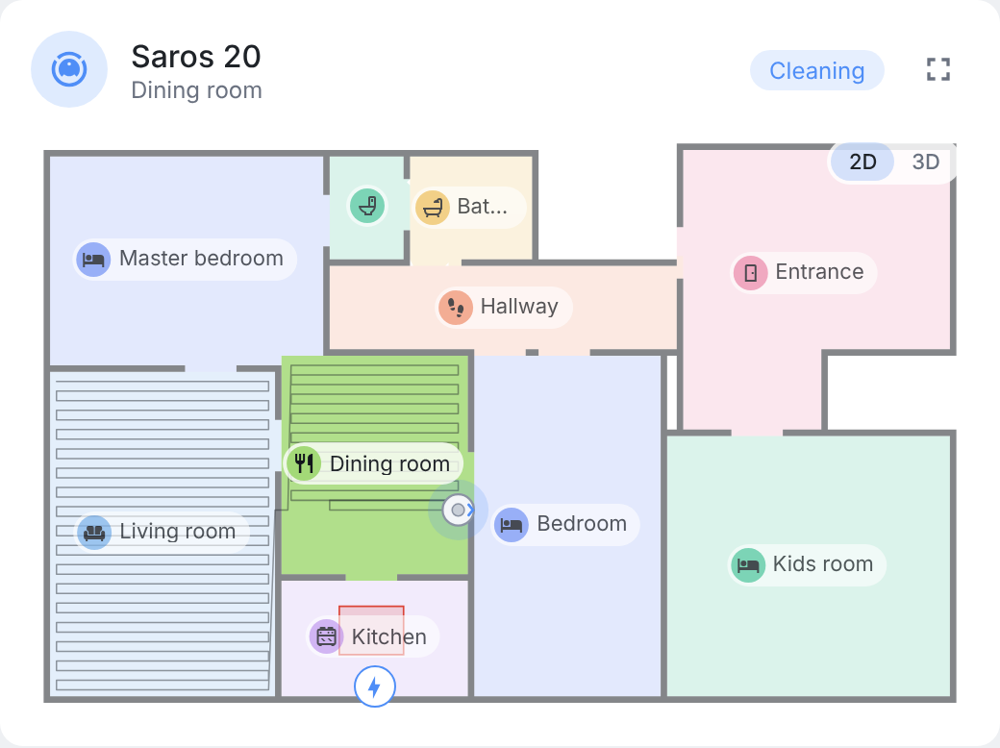
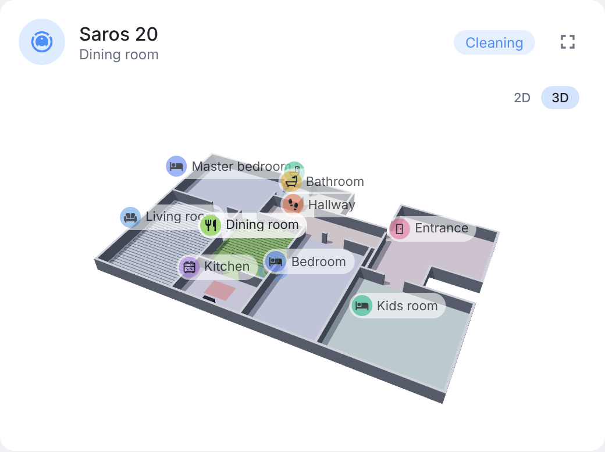

# ha-vacuum-map

[](https://www.home-assistant.io/integrations/marketplace/)
[](https://github.com/juju35/ha-vacuum-map/actions/workflows/hacs.yml)
[](https://github.com/juju35/ha-vacuum-map/actions/workflows/validate.yml)
[](https://github.com/juju35/ha-vacuum-map/releases/latest)
[](https://github.com/juju35/ha-vacuum-map/blob/main/LICENSE)
[](https://buymeacoffee.com/julienstep9)

<p align="center"></p>

Home Assistant integration and Lovelace card that draw a **clean, live map of your Roborock vacuum**: rooms with their name and an icon, walls and doors, the dock, no-go zones, and the robot travelling its path in real time — instead of the pixelated map image.

[](https://my.home-assistant.io/redirect/marketplace_repository/?owner=juju35&repository=ha-vacuum-map&category=integration)

<picture>
  <source media="(prefers-color-scheme: dark)" srcset="https://raw.githubusercontent.com/juju35/ha-vacuum-map/main/screenshots/map-dark.png">
  
</picture>
<picture>
  <source media="(prefers-color-scheme: dark)" srcset="https://raw.githubusercontent.com/juju35/ha-vacuum-map/main/screenshots/map-3d-dark.png">
  
</picture>

## Supported integrations

| Integration | Vacuums |
|---|---|
| [Roborock](https://www.home-assistant.io/integrations/roborock/) (official) | Roborock vacuums with a map in the Roborock app (S, Q, Qrevo, Saros series…) |

## Features

- **Vector map**: the outline of each room, the floor and the walls are traced from the map and simplified, so the edges are clean at any size
- **Room names and icons**: the names of the Roborock app, with an icon guessed from the name (bedroom, kitchen, bathroom…, in many languages); name, icon and color can be changed per room
- **Live robot**: between two map updates (about every 30 s while cleaning), the robot travels the new part of its path instead of jumping, and the path grows behind it
- The room being cleaned stands out, the others are dimmed
- Dock, no-go and no-mop zones, virtual walls and, optionally, obstacles
- Names too wide for a small room show the icon alone (the name stays as a tooltip)
- **3D view**: walls raised from the map, floors in their colors, the robot moving on its path; drag to turn around, pinch or wheel to zoom (three.js, loaded only for the 3D view)
- **Full screen** button: the map at its largest, in 2D or 3D
- Rotation by 90° steps, visual editor
- **No extra traffic**: the map is the one the official Roborock integration already fetches; nothing is asked to the cloud or the vacuum
- **Card bundled with the integration**, added automatically to the dashboard resources
- Light and dark themes
- English, French, German, Spanish, Italian, Dutch, European Portuguese, Polish, Romanian, Danish, Swedish, Bulgarian, Russian, Ukrainian, Hungarian, Slovak, Czech, Slovenian, Latvian, Greek and Serbian (Cyrillic and Latin), auto-detected

## Prerequisites

- Home Assistant 2025.12.1 or newer
- The official **Roborock** integration set up, with the map of your vacuum available

## Installation

### Via the Marketplace (recommended)

[](https://my.home-assistant.io/redirect/marketplace_repository/?owner=juju35&repository=ha-vacuum-map&category=integration)

Or manually:

1. Open **Settings → Marketplace → Add from link** (top right; this needs a GitHub account connected)
2. Add `https://github.com/juju35/ha-vacuum-map` — Type: **Integration**
3. Open **Vacuum Map** and click **Install**
4. Restart Home Assistant

### Manual

1. Download `vacuum_map.zip` from the [latest release](https://github.com/juju35/ha-vacuum-map/releases/latest)
2. Unzip it into `/config/custom_components/vacuum_map/`
3. Restart Home Assistant

### Removal

Remove the cards from your dashboards, delete the entry in **Settings → Devices & services → Vacuum Map** (this also removes the card resource), then uninstall the integration in **Settings → Marketplace** and restart.

## Configuration

[](https://my.home-assistant.io/redirect/config_flow_start/?domain=vacuum_map)

**Settings → Devices & services → Add integration → Vacuum Map**. There is nothing to enter: the integration follows every Roborock vacuum.

### Card

```yaml
type: custom:vacuum-map-card
entity: vacuum.saros_20
```

| Option | Default | Description |
|---|---|---|
| `entity` | — | The Roborock vacuum (required) |
| `title` | vacuum name | Card title |
| `map` | selected map | Map number, for a vacuum with several floors |
| `rotation` | `0` | `0`, `90`, `180` or `270` degrees |
| `show_labels` | `true` | Room names and icons |
| `show_path` | `true` | Path of the current or last cleaning |
| `show_zones` | `true` | No-go and no-mop zones, virtual walls |
| `show_obstacles` | `false` | Obstacles seen by the vacuum |
| `view` | `2d` | `2d` or `3d`: the view shown when the card opens |
| `show_view_toggle` | `true` | **2D / 3D** button on the map |
| `show_fullscreen` | `true` | Full screen button |
| `max_height` | `70vh` | Maximum height of the map (CSS length) |
| `rooms` | — | Per room, by number or by name: `name`, `icon`, `color`, `hidden` (hides the label) |
| `embedded` | `false` | The map alone, without card background nor header, for a card that shows it inside its own |

```yaml
type: custom:vacuum-map-card
entity: vacuum.saros_20
rotation: 90
rooms:
  16:
    icon: mdi:bed-king
    color: "#e8c46a"
  Toilets:
    hidden: true
```

### In ha-vacuum-card

[ha-vacuum-card](https://github.com/juju35/ha-vacuum-card) draws this map in its map section instead of the Roborock map picture, as soon as Vacuum Map is installed: nothing to configure.

## How it works

The official Roborock integration downloads the map of each vacuum and refreshes it about every 30 seconds while it cleans. Vacuum Map reads that map in Home Assistant — no request of its own — and turns its pixels into vectors: each room, the floor and the walls become simplified polygons (furniture legs and specks are left out). The card subscribes to a vacuum through the WebSocket command `vacuum_map/subscribe`: it receives the rooms once, then only the moving part (robot, path, zones) at each update.

To report a rendering issue, attach the diagnostics of the integration (**Settings → Devices & services → Vacuum Map → ⋮ → Download diagnostics**): they hold the raw map, which reproduces the rendering exactly. The raw map is a floor plan of your home: share it only if you are fine with that.

## Development

```bash
pip install -r requirements_test.txt && pytest       # integration tests
node --test test/*.test.mjs                          # card tests
python scripts/screenshots.py                        # screenshots/ from a made-up apartment (scripts/demo_map.py)
```

The card is plain JavaScript (`custom_components/vacuum_map/frontend/vacuum-map-card.js`), served by the integration: no build step. The 3D view uses a subset of three.js, `frontend/vendor/three.min.js`, rebuilt with `npm install --no-save three esbuild && node scripts/build-three.mjs`.

### Releasing

1. Bump the version in `custom_components/vacuum_map/manifest.json`, `VERSION` in `const.py` and `VACUUM_MAP_CARD_VERSION` in `frontend/vacuum-map-card.js`
2. Add a `## <version>` section at the top of [CHANGELOG.md](https://github.com/juju35/ha-vacuum-map/blob/main/CHANGELOG.md)
3. Push to `main`: the **Release** workflow creates the tag and the GitHub release with `vacuum_map.zip` and the changelog section as notes

## Translations

The integration and the card auto-detect the language from your Home Assistant settings. Currently supported:

| Language | Code |
|---|---|
| English | `en` |
| Français | `fr` |
| Deutsch | `de` |
| Español | `es` |
| Italiano | `it` |
| Nederlands | `nl` |
| Português (Portugal); pt-BR uses the European Portuguese texts | `pt`, `pt-BR` |
| Polski | `pl` |
| Română | `ro` |
| Dansk | `da` |
| Svenska | `sv` |
| Български | `bg` |
| Русский | `ru` |
| Українська | `uk` |
| Magyar | `hu` |
| Slovenčina | `sk` |
| Čeština | `cs` |
| Slovenščina | `sl` |
| Latviešu | `lv` |
| Ελληνικά | `el` |
| Српски | `sr` |
| Srpski (latinica) | `sr-Latn` |

Contributions for additional languages are welcome!

## License

[MIT](https://github.com/juju35/ha-vacuum-map/blob/main/LICENSE)
